  

   

  

  <h1>Deep Lexica | AI Solutions, Software Development &amp; Lexica Kit</h1>
  
<strong>Building intelligent software and purposeful digital experiences.</strong>

  

  

    
    
  

  

    
    
    
    
  

  

    
    
    
    
  

  

    
    
    
  

  

## ◈ About Deep Lexica

**Deep Lexica** builds software solutions, AI tools and automation systems designed to solve practical business problems. Our work spans **artificial intelligence, custom software development, web applications, mobile apps and connected workflows**.

This is the official GitHub profile of **Deep Lexica** (`@deeplexica`). It is also a discovery point for **Lexica** and **Lexica Kit** information, product resources and updates as they become available.

We care about clear design, useful functionality and dependable engineering.

  

## ⚡ What We Build

  

| Expertise | Focus |
| :-- | :-- |
| 🤖 **AI Solutions** | AI-powered tools, practical intelligent systems and automation |
| 💻 **Custom Software** | Purpose-built applications and software engineering |
| 📱 **Web &amp; Mobile Development** | Modern web experiences, dashboards and mobile apps |
| 🔁 **Process Automation** | Connected workflows, integrations and efficient operations |

### Inside the Deep Lexica Engineering Studio

<strong>🤖 Artificial Intelligence &amp; Applied AI</strong>

We explore business-ready AI experiences, intelligent tools, knowledge-powered applications, and practical uses of machine learning. Solutions are designed around real requirements and careful testing.

<strong>💻 Software Engineering &amp; Digital Products</strong>

Custom applications, web and mobile experiences, software architecture, integrations, dashboards, and long-term maintenance planning.

<strong>🔁 Process Automation &amp; Connected Workflows</strong>

Automation for repeatable processes, data movement between services, AI-assisted business operations, and workflow reliability.

<strong>🧩 Lexica Kit &amp; Product Updates</strong>

Looking for Lexica Kit? This GitHub profile is the official starting point for future public product resources. For confirmed availability, documentation or access, please use our [official contact email](mailto:deeplexica@gmail.com?subject=Lexica%20Kit).

## 🧩 Lexica &amp; Lexica Kit

  

**Deep Lexica** is our official company identity. **Lexica** and **Lexica Kit** are terms associated with this profile's discovery and future resources. Verified product documentation and links can be added here when publicly released.

**Looking for Lexica Kit?** Start with the [Deep Lexica GitHub profile](https://github.com/deeplexica), explore the [official website](https://www.deeplexica.com/) or [contact our team](mailto:deeplexica@gmail.com?subject=Lexica%20Kit%20Inquiry).

## 🐍 GitHub Contribution Snake

Our GitHub contribution history is visualized as a blue-and-violet animated snake, built from the actual contribution calendar of **@deeplexica**.

  <picture>
    <source media="(prefers-color-scheme: dark)" srcset="assets/github-snake-dark.svg" />
    <source media="(prefers-color-scheme: light)" srcset="assets/github-snake-light.svg" />
    
  </picture>

_The visualization reflects the actual contribution history of [@deeplexica](https://github.com/deeplexica)._

## 🔎 Find Deep Lexica on GitHub

If you are searching for **Deep Lexica**, **Lexica**, **Lexica Kit**, **AI-powered software**, **custom software development**, **intelligent automation**, or **web and mobile application development**, these are the official starting points:

- **Organization and profile:** [Deep Lexica GitHub](https://github.com/deeplexica)
- **Profile source and releases:** [Deep Lexica repository](https://github.com/deeplexica/deeplexica)
- **Lexica Kit information:** [Lexica Kit section](#-lexica--lexica-kit) and [official enquiries](mailto:deeplexica@gmail.com?subject=Lexica%20Kit)
- **Company:** [Deep Lexica official website](https://www.deeplexica.com/)

## 🌐 Official Channels

These are the established Deep Lexica contact and social accounts:

| Channel | Link |
| :-- | :-- |
| **GitHub** | [@deeplexica](https://github.com/deeplexica) |
| **Website** | [deeplexica.com](https://www.deeplexica.com/) |
| **LinkedIn** | [Deep Lexica](https://pk.linkedin.com/company/deeplexica) |
| **YouTube** | [@deeplexica](https://www.youtube.com/@deeplexica) |
| **Facebook** | [deeplexica](https://www.facebook.com/deeplexica) |
| **TikTok** | [@deeplexica](https://www.tiktok.com/@deeplexica) |
| **Email** | [deeplexica@gmail.com](mailto:deeplexica@gmail.com) |

## ❓ Quick Answers

<strong>What is Deep Lexica?</strong>

Deep Lexica is the identity behind this official GitHub account. The profile highlights artificial intelligence solutions, custom software development, connected automation, and the company's public resources.

<strong>How can I find Lexica Kit?</strong>

Use the [Lexica Kit section](#-lexica--lexica-kit) above or contact [deeplexica@gmail.com](mailto:deeplexica@gmail.com?subject=Lexica%20Kit%20Information) for confirmed information. Product details will be linked as they become available.

<strong>How do I contact Deep Lexica about AI or software projects?</strong>

You can contact us by [email](mailto:deeplexica@gmail.com) or visit the [official Deep Lexica website](https://www.deeplexica.com/).

## ✉️ Work With Deep Lexica

Have a software project, an AI automation idea or a question about Lexica Kit? Reach us at **[deeplexica@gmail.com](mailto:deeplexica@gmail.com)**. You can also explore the [Deep Lexica website](https://www.deeplexica.com/).

  
  © Deep Lexica · Official GitHub profile <a href="https://github.com/deeplexica">@deeplexica</a>

